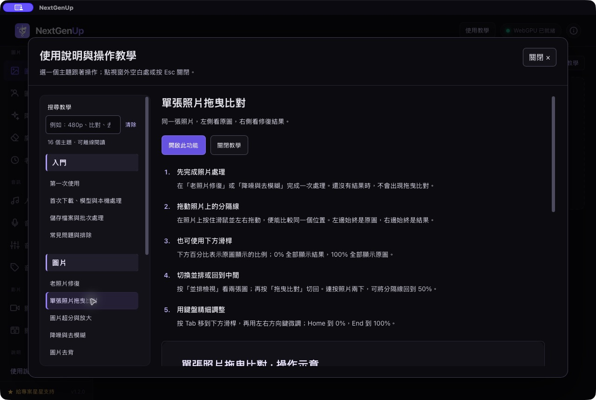

# NextGenUp 繁體中文版

> 發布準備中：目前原始碼與安裝腳本已公開，跨平台 Release 尚待 GitHub 建置驗證，資產發布前請勿交付客戶安裝。

免費開源的照片、影片與音訊處理程式，提供繁體中文介面、照片拖曳比對與內建教學彈窗。這是以 [NextGenUp 1.2.0](https://github.com/riponcm/nextgenUp/tree/16e01bb1e34baf7feb62dc70172dc5a572d3b7e8) 為基礎的社群版本，並非原作者官方中文版。

## 最簡單：交給 Codex 安裝

在**客戶電腦上的 Codex** 貼上下面這段：

```text
https://github.com/jacky391977/nextgenup-zh-tw
幫我安裝並啟用這個程式。請讀取專案的 AGENTS.md，自動辨識我的電腦，下載正確版本、完成繁體中文化並啟動，最後檢查本機 AI 和 FFmpeg 是否就緒。
```

也可以只貼專案網址加上「幫我安裝並啟用」。[AGENTS.md](AGENTS.md) 已寫明自動判斷與安裝流程。Codex 需要能執行本機工具；純聊天或遠端 Linux 容器無法直接安裝到你的電腦。

不需 GitHub 帳號、API key 或訂閱此程式。Codex 本身的帳號／方案與本程式分開。

## 支援電腦

| 電腦 | 自動安裝 | 安裝位置 |
|---|---|---|
| macOS Apple Silicon（M1／M2／M3／M4 等） | `bash install.sh` | `~/Applications/NextGenUp繁體中文版.app` |
| macOS Intel | 同上，自動選 Intel 版本 | 同上 |
| Windows 10／11 x64 | `powershell.exe -NoProfile -ExecutionPolicy Bypass -File .\install.ps1` | `%LOCALAPPDATA%\Programs\NextGenUp-zh-TW` |

Windows ARM／32 位元與 Linux 暫未提供受測安裝版本。Mac 建置以 GitHub macOS runner 測試，較舊系統相容性需另外實測。一般安裝不需管理員權限、Python、Node、Rust 或 Homebrew；第一次下載需要連網，建議留至少 3 GB 安裝空間。

[下載及建置檢查](https://github.com/jacky391977/nextgenup-zh-tw/releases) · [自動測試紀錄](https://github.com/jacky391977/nextgenup-zh-tw/actions/workflows/release.yml)



## 安裝會做什麼

1. 自動辨識 Mac 晶片或 Windows x64。
2. 直接從原作者下載固定版本 1.2.0 的官方安裝包，驗證其已固定的 SHA-256。
3. 從本專案 Release 下載對應中文化桌面殼與本機引擎，驗證 SHA-256，再套用。
4. 保留官方 FFmpeg／FFprobe 與資源、既有模型及處理資料；不強制停止正在執行的工作。
5. 啟動程式並確認繁體中文版標記、本機 AI、FFmpeg 皆就緒。重複執行同版本會跳過重裝。

這個社群版未做 Apple 公證／Windows 商業程式碼簽章。系統有時會要求使用者從正常安全性介面允許開啟；安裝程式不關閉系統保護。安裝在本機的介面僅監聽 `127.0.0.1:18790`。

## 功能與操作

| 功能 | 可以做什麼 |
|---|---|
| 圖片超分 | 2x／4x 放大，瀏覽器或本機 AI 模式 |
| 老照片修復 | 黑白上色、強化細節；臉部修復需對應模型 |
| 降噪與去模糊 | 改善照片顆粒及部分模糊 |
| 圖片去背、魔術橡皮擦 | 去背、擦除不想要的物件 |
| 影片超分 | FFmpeg 基本放大，或 Real-ESRGAN 逐影格 AI 超分 |
| 音訊工具 | 人聲分離、語音降噪、母帶處理、標籤編輯 |
| 影片工具 | 壓縮、製作 GIF、處理影片音訊 |

部分功能在第一次使用需下載各自的 AI 模型；瀏覽器 AI 元件也可能需首次載入。之後能否完全離線依功能和已備妥的元件而定。未逐一測試全部大型選用模型。

**照片比對**：在老照片修復或降噪頁面處理完成後，左側看原圖、右側看結果，拖動中間分隔線；也可切換並排檢視。

**操作教學**：右上角「使用教學」、側邊欄或工具頁「操作教學」皆可開啟。內含 16 個主題與搜尋；點彈窗外空白、按 Esc 或關閉鈕就會關閉，保留工作頁面的照片及設定。

**480p 轉 4K**：4x 是寬高各放大 4 倍，854×480 會變成 3416×1920，並不直接等於 3840×2160。此版沒有自訂尺寸欄位。AI 推測細節，不能保證恢復原本不存在的內容或達到原生 4K 拍攝品質。

**儲存**：處理完成後還要按「儲存」並選擇資料夾，才會另存結果；保留原始檔。

## 檢查、更新與移除

在專案目錄執行：

```bash
# Mac：檢查目前執行中的程式
bash install.sh --doctor
```

```powershell
# Windows：檢查目前執行中的程式
powershell.exe -NoProfile -ExecutionPolicy Bypass -File .\install.ps1 -Doctor
```

此分支停用官方自動更新，避免變回英文。更新請使用本專案對應的新版本安裝程式。升級既有社群版時保留上一版程式備份；這不是使用者媒體的額外備份。

Mac 移除程式可正常結束後移除 `~/Applications/NextGenUp繁體中文版.app`；Windows 可用系統「已安裝的應用程式」移除 NextGenUp。使用者資料不自動刪除；如曾裝過官方版，同一電腦的模型與資料路徑可能共用，勿任意清理。

## 開發與授權

完整中文介面、後端及桌面殼原始碼皆在此專案；建置指引見 [docs/BUILD.md](docs/BUILD.md)，發布變更見 [docs/RELEASE.md](docs/RELEASE.md)。正式套件只有在三平台安裝與處理測試全數成功後才發布。

保留原作者 **Ripon Chandra Malo** 的 [MIT 授權](LICENSE)。本專案修改亦採 MIT。第三方引擎、模型與 FFmpeg 仍適用各自授權，詳見 [THIRD_PARTY_NOTICES.md](THIRD_PARTY_NOTICES.md)。
